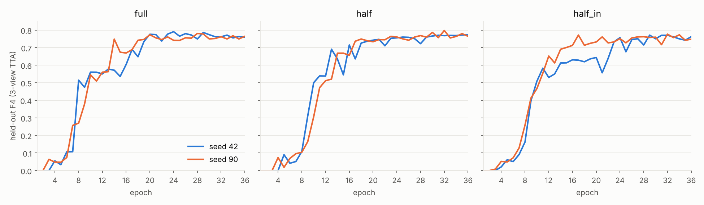

# BPD — particle picking in cryo-electron tomograms with a 350K-parameter 3D U-Net

[](https://github.com/y284/czii-bpd/actions/workflows/ci.yml)

Locate 5 types of protein complexes (apo-ferritin, β-galactosidase, ribosome, thyroglobulin, virus-like particle) in 184×630×630 cryo-electron tomograms, scored with a weighted F-β (β = 4).

## Competition solution — 5th of 931, gold medal

The solution submitted to [CZII — CryoET Object Identification](https://www.kaggle.com/competitions/czii-cryo-et-object-identification), private score **0.7825**, published by the Chan Zuckerberg Imaging Institute as the official model card [**BPD**](MODEL_CARD_URL).

- **Detection as segmentation.** Each particle is labelled as a small sphere and every voxel is classified into background + 5 classes; particles are the connected components above per-class thresholds, their centroids the predictions.
- **3D U-Net designed from scratch.** 350,830 parameters (1.4 MB), trained on random 128³ crops with flips, 90° rotations and intensity jitter.
- **Inference.** 72 overlapping 128³ windows per tomogram, 7-view test-time augmentation, ensemble of 4 seeds. The final models were trained on all 7 training runs.

## Post-competition work

Done afterwards on a held-out tomogram (`TS_5_4`), with models trained on the other 6 runs, 2 seeds per variant, and the competition thresholds unchanged.

- **Half-resolution decoder (`half`):** the decoder stops at 1/2 resolution, so particle extraction runs on 8× fewer voxels.
- **InstanceNorm variant (`half_in`):** tested as a way to train faster.
- **Lighter inference:** full-depth windows (36 per tomogram instead of 72) and 3 views (identity, z-flip, 90° rotation) instead of 7.
- **Model selection by TTA:** every epoch is scored with 3-view TTA, less noisy than a single view, and the best epoch is kept.
- **TensorRT FP16 export,** checked against PyTorch on the whole held-out tomogram.
- **Engineering:** uint8 tomograms (73 MB instead of 146 MB), one model per GPU in parallel threads, bf16 or fp16 chosen per GPU, tests and CI.

| variant | output | normalisation | best F4 (seed 42 / 90) | mean F4, epochs 20–36 | training time |
|---|---|---|---|---:|---:|
| `full` | full resolution | BatchNorm | 0.791 / 0.781 | 0.763 | 189 min |
| **`half`** | 1/2 resolution | BatchNorm | 0.772 / 0.798 | 0.758 | **100 min** |
| `half_in` | 1/2 resolution | InstanceNorm | 0.771 / 0.777 | 0.736 | 109 min |



Inference on `TS_5_4`, one T4, seed-42 model:

| variant | backend | network | particle extraction | total | F4 | speed-up |
|---|---|---:|---:|---:|---:|---:|
| `full` | PyTorch FP16 | 11.5 s | 4.9 s | 16.5 s | 0.791 | 1.0× |
| `full` | TensorRT FP16 | 6.5 s | 5.0 s | 11.4 s | 0.791 | 1.4× |
| `half` | PyTorch FP16 | 6.1 s | 0.6 s | 6.7 s | 0.772 | 2.5× |
| **`half`** | **TensorRT FP16** | **3.4 s** | **0.6 s** | **3.9 s** | **0.772** | **4.2×** |

- **Half resolution** matches full-resolution accuracy, trains 1.9× faster and runs 2.5× faster.
- **TensorRT** gives the same F4 as PyTorch (probabilities within 0.005); with half resolution, inference is **4.2× faster** than the full-resolution model under PyTorch.
- **InstanceNorm** did not help: no faster training (109 vs 100 min), later convergence, about 0.01 lower F4.

## Usage

```bash
pip install -e ".[export]"
python -m czii_bpd.train --variants full half half_in --seeds 42 90 --fold 0
python -m czii_bpd.export --checkpoints outputs/model_*_seed42_best.bin
```

The Kaggle runs behind these results are in [`notebooks/`](notebooks), the raw numbers in [`results/`](results). `pytest -q` checks each variant's output resolution, checkpoint loading and ONNX export; CI runs it with `ruff` on every push.

*Post-competition results come from a single held-out tomogram (about 130 particles): F4 differences around ±0.01 are within noise.*

## License

MIT
