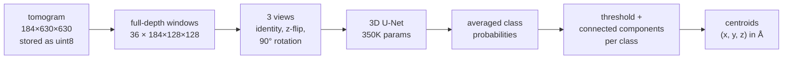

# BPD — particle picking in cryo-electron tomograms with a 350K-parameter 3D U-Net

[](https://github.com/YOUR_USER/czii-bpd/actions/workflows/ci.yml)

**5th of 931 teams — gold medal** in the Kaggle competition [CZII — CryoET Object Identification](https://www.kaggle.com/competitions/czii-cryo-et-object-identification) (score 0.7825). The model is published by the Chan Zuckerberg Imaging Institute as the official model card [**BPD**](MODEL_CARD_URL).

The task: find the centre of every protein complex of 5 types (apo-ferritin, β-galactosidase, ribosome, thyroglobulin, virus-like particle) in 184×630×630 tomograms, scored with a weighted F-β (β = 4).

This repository is the cleaned-up solution plus what was improved after the competition: **a half-resolution model and a TensorRT FP16 engine, for faster inference at the same accuracy.**

## Method



- **Detection as segmentation.** Each particle is labelled as a small sphere (radius 0.8·log2 of its radius in voxels) and the network classifies every voxel into background + 5 classes. Particles are the connected components above a per-class threshold; their centroids are the predictions.
- **A small network.** A 3-level 3D U-Net (28/32/36 channels, 350,830 parameters, 1.4 MB) trained from scratch on random 128³ crops with flips, 90° rotations and intensity jitter.
- **Inference.** The network is fully convolutional, so each window spans the whole depth (184×128×128, 36 windows per tomogram, overlapping in y and x and weighted towards their centre). Each window is predicted in 3 views and the probabilities are averaged. The thresholds are the ones used in the competition, never tuned again.

## Post-competition improvements

Both variants are trained with 2 seeds on 6 runs and scored on the held-out tomogram `TS_5_4` after every epoch; the best epoch is kept. All numbers below use the same inference (3 views, full-depth windows, competition thresholds).

- **Half-resolution output (`half`).** The decoder stops at 1/2 resolution: the full-resolution stage and the transposed upsampling are gone, so the network does less work and the connected components run on 8× fewer voxels. Labels are rendered on the coarse grid with the half-voxel shift of trilinear downsampling taken into account (`render_labels`).
- **TensorRT FP16.** The model is exported to ONNX and built into a TensorRT engine, then checked on the whole held-out tomogram against PyTorch autocast: same F4, probabilities within a small tolerance.
- **TTA for model selection.** Scoring each checkpoint with TTA instead of a single view gives a steadier curve, so the best epoch is chosen on less noise: in an earlier run, TTA scored higher than single-view evaluation for all 4 models and at 24 of 36 converged checkpoints, with smaller epoch-to-epoch jumps for 3 of the 4.

### Accuracy — held-out F4 per epoch

_Results from the Kaggle runs go here._

### Speed and export check — `TS_5_4`, one T4

_Results from the Kaggle runs go here._

## Design notes

- **uint8 tomograms.** Volumes are normalised to the training intensity window and stored on 256 levels over [−0.5, 1.5] in normalised units, which keeps the tails below the 5th and above the 99th percentile: 73 MB per tomogram instead of 146 MB in float16, rounding error ±0.004.
- **One GPU per model.** With 2+ GPUs, independent models (one per seed and variant) train in parallel threads, one per GPU, instead of `DataParallel`. With a single GPU they run one after another. Models are built in the main thread, so a model's initialisation depends only on its seed.
- **Mixed precision.** bfloat16 on GPUs that support it natively (compute capability ≥ 8), float16 with gradient scaling otherwise (Kaggle's T4).
- **Architecture from the checkpoint.** `load_model` reads whether a checkpoint is full or half resolution from its weights. The competition checkpoints load unchanged.

## Usage

```bash
pip install -e .                    # add ".[export]" for ONNX Runtime and TensorRT
export CZII_DATA=/path/to/czii-cryo-et-object-identification   # found automatically on Kaggle

python -m czii_bpd.train --variants full half --seeds 42 90 --fold 0 --eval tta
python -m czii_bpd.export --checkpoints outputs/model_full_seed42_best.bin outputs/model_half_seed42_best.bin
```

`train` writes `model_<variant>_seed<seed>_best.bin` (best held-out F4), `model_<variant>_seed<seed>.bin` (last epoch), `history.csv` and `results_training.json`; `--eval plain` scores epochs on a single view, `--smoke` runs 2 short epochs. `export` writes the ONNX files and `results_export.json`.

On Kaggle, the notebooks in [`notebooks/`](notebooks) run the same commands (GPU T4 ×2).

## Tests

```bash
pip install -e ".[dev]" && pytest -q
```

Check that `full` predicts at the input resolution and `half` at half of it, and that both export to ONNX with ONNX Runtime matching PyTorch. CI runs it with `ruff` on every push.

## Limitations

- The post-competition numbers come from a single held-out tomogram (about 130 particles), so differences around ±0.01 F4 are within noise.
- The matching uses one-to-one assignment, close to but not identical with the official metric, so absolute scores differ slightly from the leaderboard.

## Layout

```
src/czii_bpd/
  config.py    paths, particles, thresholds
  data.py      uint8 loading, label rendering, training crops
  model.py     3D U-Net, checkpoint loading
  infer.py     full-depth windows, TTA views, connected components, metric
  utils.py     devices, mixed precision, one-model-per-GPU runner
  train.py     training with per-epoch held-out evaluation
  export.py    ONNX / TensorRT export and check
tests/         output resolution of each variant, ONNX export check
notebooks/     Kaggle notebooks
```

## License

MIT
